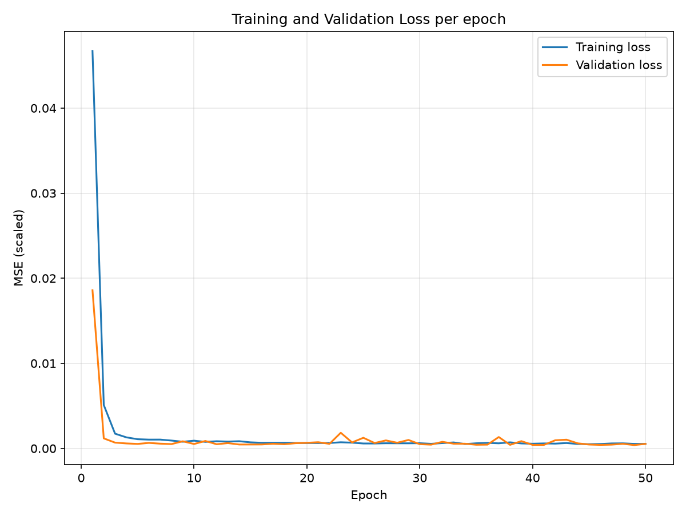
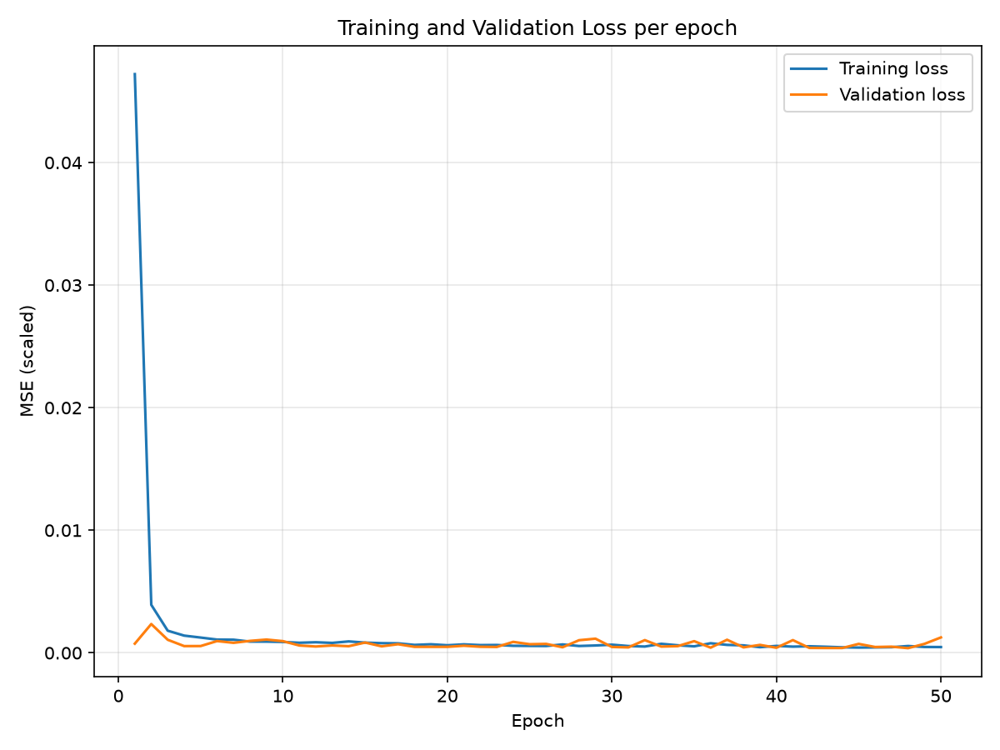
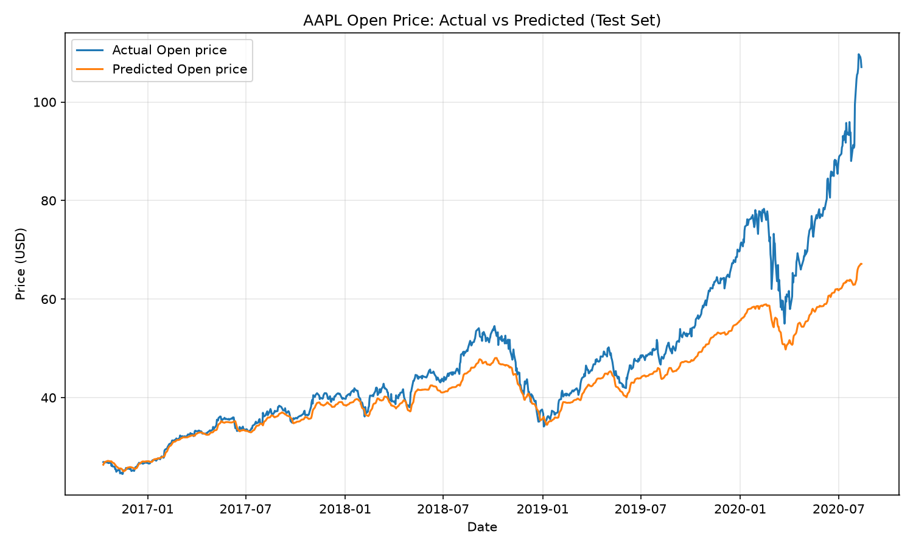
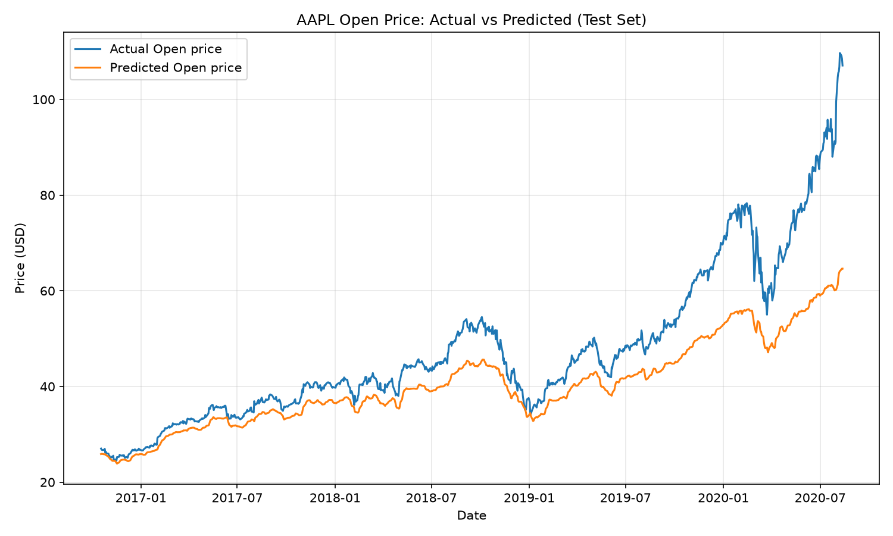

# Stock Price Prediction with a Two-Layer RNN

A PyTorch replication of an RNN-based stock price prediction experiment, applied to Apple (AAPL) daily Open prices. The model uses the last few days of prices (5 or 10) to predict the next day's price.

**Paper:** [Stock price prediction using the RNN model](https://iopscience.iop.org/article/10.1088/1742-6596/1650/3/032103), Yongqiong Zhu, *Journal of Physics: Conference Series*, Volume 1650, 2020. DOI: [10.1088/1742-6596/1650/3/032103](https://doi.org/10.1088/1742-6596/1650/3/032103)

## Files

| File | Purpose |
|---|---|
| `fetch_aapl.py` | Downloads AAPL price history with `yfinance` and saves it to `aapl_prices.csv` |
| `aapl_prices.csv` | Daily AAPL prices, 2009-08-10 to 2020-08-12 (2,772 rows) |
| `rnn_pytorch_stock_prediction.py` | Data preparation, model, training, validation, test evaluation and plots |
| `assets/` | Figures from the run reported below |

## Setup

Requires Python 3 with the following packages:

```
pip install torch pandas numpy scikit-learn matplotlib yfinance
```

`yfinance` is only needed if you want to re-download the data.

## Running the experiment

```
python rnn_pytorch_stock_prediction.py
```

The number of timesteps is set by `TIMESTEPS` near the top of the script (line 41). Set it to `5` or `10` to reproduce either setting. The script trains on the first 65% of the data and tests on the rest. It prints the loss for each epoch, the test MSE, RMSE and MAE in dollars, and plots the actual against predicted test prices.

To re-download the data first, run `python fetch_aapl.py`. This overwrites `aapl_prices.csv`.

## Model

| Setting | Value |
|---|---|
| Input size | 1 (scaled Open price) |
| Timesteps | 5 or 10 |
| First RNN layer | 50 units |
| Second RNN layer | 100 units |
| Dropout | 0.2, between the two RNN layers |
| Output | 1 (next day's scaled Open price) through a linear layer |
| Batch size | 64 |
| Epochs | 50 |
| Optimiser | Adam (default learning rate 0.001) |
| Loss | MSE |

## Data handling

- The first 65% of days are used for training and the last 35% for testing.
- The last 10% of the training windows are held out as a validation set, in time order. The paper instead uses the test set as its validation set.
- Prices are scaled to [0, 1] with `MinMaxScaler`, fit on the training data only.
- The training loader shuffles each epoch. The validation and test loaders keep time order.
- Random seeds are fixed (`SEED = 42`) so runs are repeatable.
- Prices come from `yfinance` with `auto_adjust=True`, which adjusts them for stock splits and dividends.

Choices not given in the paper, such as the validation split, the learning rate and the random seed, were made here.

## Results

Test set metrics, with predictions converted back to USD. Figures below are from the same run.

| Metric | Timesteps = 5 | Timesteps = 10 |
|---|---|---|
| MSE (USD²) | 82.8626 | 114.7561 |
| RMSE (USD) | 9.1029 | 10.7124 |
| MAE (USD) | 5.3776 | 7.3850 |
| MAPE | 8.54% | 12.77% |
| Accuracy (100 − MAPE) | 91.46% | 87.23% |
| Mean bias (predicted − actual, USD) | −5.30 | −7.38 |

### Training and validation loss

Timesteps = 5:



Timesteps = 10:



### Actual vs predicted (test set)

Timesteps = 5:



Timesteps = 10:



## Comparison with the paper

The paper's Table 3 reports the following test metrics:

| Metric | Paper, timesteps 5 | This replication, timesteps 5 | Paper, timesteps 10 | This replication, timesteps 10 |
|---|---|---|---|---|
| MSE | 68.4920 | 82.8626 (+21%) | 109.2181 | 114.7561 (+5%) |
| RMSE | 8.2760 | 9.1029 (+10%) | 10.4507 | 10.7124 (+2%) |
| MAE | 5.9038 | 5.3776 (−9%) | 7.8354 | 7.3850 (−6%) |

The hyperparameters in the paper's Table 2 (input size 1, 50 and 100 units, dropout 0.2, batch size 64, 50 epochs, Adam, MSE) are the same as the ones used here.

Both results show the same pattern:
- Timesteps 10 is worse than timesteps 5 on all three metrics, as the paper reports.
- The paper's conclusion that RNN errors grow with timesteps is reproduced.

The paper's headline claims are not reproduced:
- **Accuracy over 95%.** The paper doesn't define accuracy. With the common definition of 100 minus the mean absolute percentage error, this replication gives 91.46% (timesteps 5) and 87.23% (timesteps 10).
- **Loss close to 0.1%.** The paper doesn't state the units of its loss. The scaled test-period losses here are around 0.0004 to 0.0005 (0.04% to 0.05%), so the order of magnitude is similar, but the two can't be compared without knowing the paper's definition.

## Why the results differ

1. **Different price data.** The paper's Table 1 lists opening prices of about 35 to 37 USD for 9 to 16 August 2010. The CSV from `fetch_aapl.py` shows about 7.4 to 7.8 USD for the same dates, roughly 4.8 times lower. The most likely cause is price adjustment: `auto_adjust=True` adjusts every price for all later splits and dividends, while the paper's download probably used a different adjustment. Because the prices are on a different scale, the MSE, RMSE and MAE values can't be compared directly with the paper's.
2. **Different validation set.** The paper uses the test set as its validation set, so the test data influences training choices. This replication holds out a separate validation set from the training period.
3. **Different framework.** The paper uses TensorFlow 2.0 and this replication uses PyTorch. Weight initialisation, the RNN implementation and the Adam settings differ in small ways that change the results.
4. **Unspecified details in the paper.** The paper doesn't state the learning rate, the dropout placement, the random seed, or whether the inputs were scaled. Table 1 shows unscaled prices even though Equation 1 describes scaling. This replication uses the PyTorch default learning rate (0.001), puts dropout between the two RNN layers, and scales the inputs to [0, 1].
5. **Different data range and split details.** The paper describes data from 9 August 2009 to 12 August 2020. The CSV here starts on 10 August 2009, the first trading day in that period. The 65/35 split is applied to the rows in the CSV, so the exact test dates may differ slightly.
6. **Hardware and randomness.** The paper ran on an i7-9750H with an RTX 2070. This replication used the Apple GPU (MPS) or CPU, and the seed is fixed, but GPU operations are not fully deterministic.

The error pattern also differs. Mean bias is large and negative, so the model consistently predicts below the actual price, and the gap widens through 2020 (see the test plots). This is consistent with the model lagging a rising price. MAE is lower than the paper's, but MSE and RMSE are higher, so this replication has a few large misses that the paper's model doesn't.

The paper's figure 4 shows the loss flattening after epoch 30. In this replication the validation loss still has spikes after epoch 30, so the curve is less stable than the paper describes.
